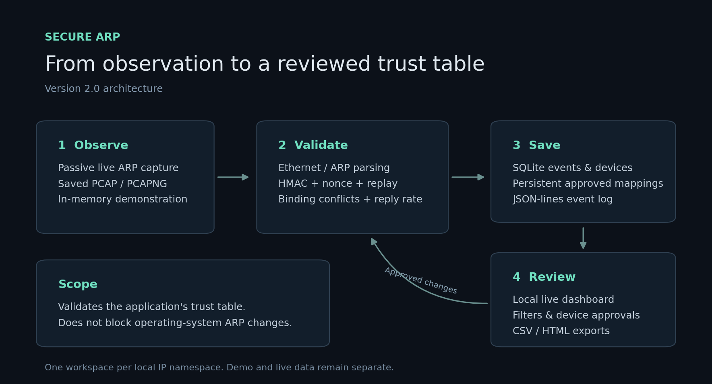

# Secure ARP — Monitoring, Authentication & Device Review

An expanded version of the original Python project with a live local dashboard, persistent history, device approvals, exports, configuration, offline packet analysis, and stronger replay protection.

**Scope:** this is a passive ARP monitor and an authenticated application trust-table demonstration. It does not intercept or block the operating system's ARP cache updates. Ordinary ARP hosts do not automatically produce Secure ARP tags.

Start with **START_HERE.md** for the quickest demonstration.

## Requirements and installation

- Python 3.10 or newer.
- The interactive demo and dashboard use the standard library.
- Install requirements.txt for packet-file analysis, live capture, and chart generation.
- Live capture additionally needs administrator/root access and an appropriate capture backend. Windows requires Npcap. It is not required for the in-memory demo or saved-file analysis.

From the extracted project folder:

~~~bash
python -m pip install -r requirements.txt
~~~

Optional isolated setup on Windows:

~~~powershell
py -3 -m venv .venv
.\.venv\Scripts\python.exe -m pip install -r requirements.txt
.\.venv\Scripts\python.exe -m secure_arp --demo
~~~

Optional isolated setup on Linux/macOS:

~~~bash
python3 -m venv .venv
.venv/bin/python -m pip install -r requirements.txt
.venv/bin/python -m secure_arp --demo
~~~

## 1. Interactive demonstration

~~~bash
python -m secure_arp --demo
~~~

Open http://127.0.0.1:8765.

The first launch creates demonstration data automatically. **Run demonstration** adds another comparison. The scenarios cover valid replies, conflicting MAC addresses, missing/tampered authentication, repeated authenticated replies, expired authentication, and reply floods.

Each synthetic reply is analyzed once in standard mode and once in secure mode. Therefore the workspace's reply counter counts two analysis passes. One reply can produce several findings.

The demo uses data/demo.sqlite3 and logs/demo_events.jsonl. Live monitoring uses different files. Demonstrations never transmit packets.

If the port is busy:

~~~bash
python -m secure_arp --demo --port 8766
~~~

The dashboard runs only on the local computer. Leave its terminal open; stop it with Ctrl+C.

## 2. Dashboard features

| Feature | Behavior |
|---|---|
| Live refresh | Reads new events and device observations every configured interval; pause/resume is available. |
| Activity charts | Shows event counts per minute and category totals for the current filters. |
| Search and filters | Searches IP, MAC, and detail text; filters by severity, type, mode, source, and local date/time. |
| Pagination | Displays 50 events per page. |
| CSV export | Downloads every matching event, including events beyond the current page. |
| HTML report | Downloads a printable summary and event table for the current filters. |
| Device review | Lists observed IP–MAC pairs, first/last observation data in storage, reply counts, and conflict/approval status. |
| Device approvals | Saves a name and a verified mapping; replacing a mapping requires an explicit action. |
| Notifications | Optional desktop notifications and sound, plus in-page critical alerts. |
| Settings | Shows current configuration. Edit config.json and restart to apply changes. |

The **Observed IPs** metric counts distinct observed IPv4 addresses, not necessarily distinct physical computers. Device rows distinguish different MAC addresses for the same IP.

Notifications cover new critical events while the page is open, even when the table's filters hide those events. Existing history does not trigger notifications on first load. A cooldown limits repeated notifications; every finding is still saved. Desktop notification permission and audio must be enabled through the page. Browser support and permissions vary.

## 3. Live passive monitoring

Start the dashboard in one terminal:

~~~bash
python -m secure_arp
~~~

Start the capture monitor in another terminal with capture permissions:

~~~bash
sudo python -m secure_arp.monitor --iface eth0 --mode standard
~~~

Use the interface name appropriate for your computer. On Windows, use an Administrator terminal and an interface identifier supported by Scapy/Npcap.

The dashboard will show **Monitor connected** when the capture process is sending heartbeats. Stopping the dashboard does not stop a separately running monitor, and stopping the monitor does not delete history.

Only capture traffic on a network you are authorized to monitor. Monitoring is passive; the application has no packet-transmission or automatic network-blocking feature.

The live capture filter targets ARP replies on Ethernet-compatible interfaces. Requests, IPv6 neighbor discovery, and non-Ethernet capture types are outside the detector's scope. Tagged Ethernet frames are supported by the saved-capture parser; live capture visibility also depends on the interface and capture filter.

### Secure mode

Use a private shared key of at least 16 bytes, preferably 32 random bytes or more. Store it in the environment variable named by the psk_env setting, normally SECURE_ARP_PSK. The project does not save the key to its database or config file.

After setting that variable in the privileged capture environment:

~~~bash
python -m secure_arp.monitor --iface eth0 --mode secure
~~~

On Unix, sudo can remove environment variables. Set the key in the environment used to run the monitor or explicitly preserve that one variable according to your local sudo policy.

Secure mode requires cooperating senders to append the project's authentication tag to their ARP replies. The signing API is SecureARPAuth.sign(ip, mac); no sender daemon or operating-system ARP integration is included. Normal unsigned replies produce authentication-failure events.

The pre-shared key authenticates membership in the key-sharing group. Any holder of that group key can create a valid tag; explicit device approvals are still needed to associate a particular IP with a MAC.

The legacy --psk argument is retained for compatibility, but environment-based key loading avoids exposing a key in the command line.

## 4. Trusted devices and persistence

Open **Devices**, independently verify an IP–MAC pair, give it a name, and save its approval.

- New observations are visible even when authentication fails. An observation is not automatically an approval.
- Standard mode learns the first unseen mapping as a baseline. This first observation is not proof of identity.
- Secure mode learns a new baseline only after successful authentication.
- A conflicting mapping never silently replaces a baseline, including after the original lock window expires.
- The lock_seconds setting now distinguishes a recently learned baseline from an older one in event details; expiry does not approve a MAC change.
- Approved mappings, learned baselines, observations, events, and recently accepted authentication tags survive monitor restarts.
- Removing explicit approval preserves the baseline, name, and history.
- Changes made in the device manager are picked up by the capture engine for subsequent packets.

You may seed previously unknown IPs from a JSON file:

~~~bash
python -m secure_arp.monitor --static-bindings examples/static_bindings.json
~~~

The sample uses documentation-only addresses and must be changed for a real network. Seeding does not overwrite existing database entries; use the device manager to review or replace those entries.

Use one capture process per workspace/database. The current trust model is a single local IP namespace; it does not separate overlapping address spaces by VLAN or interface.

## 5. Offline PCAP / PCAPNG analysis

~~~bash
python -m secure_arp.pcap_analyzer reports/demo/sample_arp.pcap
~~~

With an explicit new output folder:

~~~bash
python -m secure_arp.pcap_analyzer capture.pcap --output-dir reports/my_capture
~~~

With approved starting bindings:

~~~bash
python -m secure_arp.pcap_analyzer capture.pcap --static-bindings examples/static_bindings.json
~~~

Secure capture analysis requires the matching sender key in SECURE_ARP_PSK:

~~~bash
python -m secure_arp.pcap_analyzer capture.pcap --mode secure
~~~

For the supplied demonstration capture only, the public demo key is:

~~~text
demo-only-key-not-for-a-real-network
~~~

The analyzer writes report.html, events.csv, events.jsonl when there are findings, and analysis.sqlite3. It uses an isolated database, so replaying old captures cannot replace current live approvals.

Analysis uses capture timestamps for rate windows and authentication freshness. It does not compare historical packets with today's wall clock. Both Ethernet PCAP and PCAPNG are supported, including VLAN-tagged Ethernet. Unsupported link-layer records and malformed replies are counted and skipped. Out-of-order timestamps are reported because rate interpretation may be less reliable.

An explicit output directory must be new or empty. Existing analysis results are never silently overwritten. With no output directory specified, a timestamped folder is created automatically.

## 6. Configuration

All file paths in config.json are resolved relative to the configuration file.

| Setting | Default | Purpose |
|---|---|---|
| database_path | data/secure_arp.sqlite3 | Persistent live workspace |
| log_path | logs/events.jsonl | JSON-lines event log |
| report_dir | reports | Generated reports |
| static_bindings_path | null | Optional initial approved mappings |
| interface | null | Default capture interface |
| mode | standard | Live detector mode |
| lock_seconds | 300 | Recently learned classification window |
| flood_window_seconds | 2 | Rate-detection interval |
| flood_threshold | 8 | A warning begins above this many replies per IP in the interval |
| max_clock_skew_seconds | 5 | Allowed authenticated timestamp difference |
| replay_cache_size | 10000 | Maximum unexpired authentication records |
| alert_cooldown_seconds | 15 | Minimum gap between critical notifications |
| refresh_seconds | 2 | Dashboard polling interval |
| web_port | 8765 | Local dashboard port |
| psk_env | SECURE_ARP_PSK | Environment variable containing the shared key |

Pass --config path/to/config.json to the dashboard, demo harness, monitor, or analyzer. Command-line overrides take precedence where provided. Invalid settings produce an error rather than being silently ignored.

## 7. Authentication and detection changes

The version-1 authentication trailer is 45 bytes:

| Field | Bytes |
|---|---:|
| Magic marker SARP | 4 |
| Version | 1 |
| Timestamp, big-endian double | 8 |
| Random nonce | 16 |
| Truncated HMAC-SHA256 | 16 |

The HMAC covers the full trailer header plus the binary sender IPv4 and MAC addresses. Timestamp validation rejects stale/future messages beyond the configured tolerance. The nonce distinguishes independently generated messages, including messages with the same timestamp.

Accepted authenticated messages are remembered until their freshness interval expires. Repetition is rejected even inside the timestamp window, including after a monitor restart when using the persistent engine. If the cache is full, authentication fails closed until space expires. The low-level authenticator also supports a bounded in-memory replay cache.

This trailer replaces the original 24-byte timestamp-only format. Updated receivers intentionally reject that legacy format; cooperating senders must use the updated signing code.

The detector now reports authentication failure, MAC conflict, and a flood warning together when they apply to one reply. The old early flood return no longer hides critical events. The event name ARP_REPLY_FLOOD reflects that the detector counts all observed replies, not only gratuitous announcements.

## 8. Reports and project layout

~~~text
secure_arp/
  __main__.py          dashboard entry point
  config.py            validated JSON settings
  crypto_auth.py       HMAC, nonce, freshness and replay checks
  detector.py          independent binding, authentication and flood checks
  trust_store.py       learned and approved IP–MAC baselines
  storage.py           SQLite history, observations and approvals
  engine.py            shared packet-processing workflow
  packet_io.py         Ethernet/ARP parsing and offline sample generation
  monitor.py           live Scapy capture and terminal display
  pcap_analyzer.py     isolated saved-capture analysis
  web.py              local dashboard and JSON/export endpoints
  reports.py          CSV and printable HTML output
  dashboard.py        report/chart generation
  demo_harness.py     deterministic scenario structure, with fresh timestamps/nonces
  static/             HTML, CSS and JavaScript dashboard
tests/                detector, security, persistence, PCAP and HTTP tests
examples/             sample trusted bindings
reports/demo/         pre-generated demonstration reports and sample capture
assets/               chart, static report and architecture diagram
config.json           default settings
START_HERE.md         quick run instructions
CHANGELOG.md          additions and compatibility notes
VALIDATION.md         testing evidence and limits
~~~

Live runtime data is created when needed. The archive contains no real network captures, private keys, or populated live database. Example captures contain only synthetic traffic.

## 9. Run tests

~~~bash
python -m pip install -r requirements-dev.txt
python -m pytest -q
~~~

Tests do not capture or transmit network traffic. HTTP integration tests use a temporary local server and temporary databases.

## Troubleshooting

- **Address already in use:** use --port 8766, then open the printed address.
- **No new live events:** start the capture monitor separately and check its interface, permissions, and capture backend.
- **Secure mode reports missing authentication:** ordinary devices do not send this custom trailer; use standard mode for those devices.
- **Legitimate MAC change:** verify the new address and explicitly approve it in Devices.
- **Permission error during Scapy initialization:** the interactive demo still works without Scapy. Use a machine with the required capture access for live monitoring.
- **No desktop popup or sound:** enable it in Event history and check the browser's notification/audio permissions.
- **Dependencies installed for a different Python:** install with the same interpreter used to launch the program, using python -m pip.
- **Live and demo histories differ:** they intentionally use separate databases; use the same mode and configuration when opening the relevant workspace.
